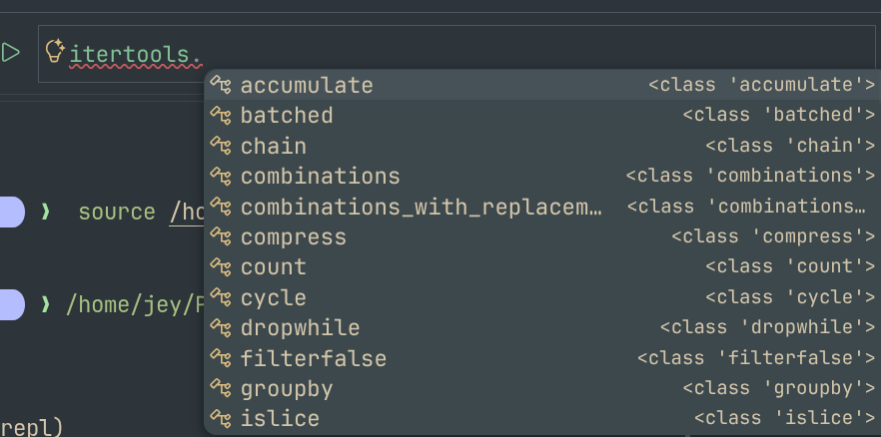
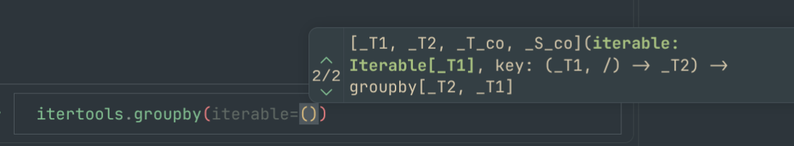

# RFC 0002: Auto Complete Support

| | |
| --- | --- |
| Status | Draft |
| Date | 2026-10-28, updated 2026-10-29 |
| Progress | Steps 0 to 3 and 6 done in 0.14.0, and most of 5 - see [Step 0 Findings](#step-0-findings) and [As Built](#as-built) |
| Affects | Live and API modes, `homeassistant_repl.connect()`, a new server command for live mode |

## Summary

Provide the help an editor gives for Python, in the REPL itself and for the live objects inside Home Assistant:

- Completion of names, attributes and keys as you type
- The signature of the function being called, and which argument the cursor is on
- The docstring of an object (the "hover" of an editor)
- The source of an object (the "jump to definition" of an editor)

and some things only a Home Assistant aware shell can do:

- Completion of entity ids, actions, `obj` paths and `hass.data` keys inside string literals
- Completion of recorder tables and columns inside `sql("...")`
- A marker showing where the statement being typed will run, and a warning before Enter when it can't run at all

Everything is idempotent by default: asking for a completion never runs a property, a `__getattr__`, a `__getitem__` on an unknown type, or a call.

### VSCode REPL Examples

{width=300}
{width=300}

## Motivation

Most of what live mode is for is finding out what is there: what an object holds, what a method takes, what an entity is called. Today that is `help()`, `show()` and `dir()`, one round trip at a time, and the entity id has to be typed exactly or found first with `obj.find()`.

Editor style completion would close that loop, but an editor's language server can't see what matters here. The objects live inside a running Home Assistant, a different process, often in a different container, often a different version from anything installed locally. Static analysis on the client would have to guess what `hass.data["sensor"]` holds, or which class an entity of a custom component really is. The only place that knows is the server.

## Design

### Two namespaces, one routing rule

Live mode runs each statement on one side or the other ([What Runs Where](../../../modes/live_mode.md#what-runs-where)): a statement that reads `hass`, `obj`, or a variable an earlier server-side statement left behind is sent to Home Assistant, and everything else runs locally (`LiveSession._next_chunk` in `repl.py`).

Completion follows exactly the same rule, applied to the statement the cursor is in:

| Typed | Answered by |
| ----- | ----------- |
| `df.fil` | Local, `df` is a local dataframe |
| `hass.states.async_` | Server |
| `s.attr` after `s = hass.states.get("sun.sun")` | Server, `s` lives there |
| `for e in hass.states.async_all(): e.ent` | Server, the statement reads `hass`, so `e` is the server's |
| `sql("select * from st` | Local, `sql` is local and knows the tables |
| `pri` (a bare name) | Both, merged, with each item marked by side |

The statement under the cursor is usually incomplete, so it can't be given to `ast`. The client parses it with parso (error tolerant, and already present as jedi's own parser) to find the names it reads, and checks them against the same set of remote names `LiveSession` keeps. That logic, `_Names` and the remote name set, moves out of `repl.py` into a module both use, so execution and completion can't disagree about where a statement runs.

A remote request carries the whole of the current input (all the lines typed so far at `...` prompts) and the cursor offset, not just the current line, so that a name bound earlier in the same block can be inferred.

### Server: `ha_repl_server/complete`

A new admin-only websocket command, alongside `exec`:

```json
{
  "type": "ha_repl_server/complete",
  "session": "default",
  "source": "for e in hass.states.async_all():\n    e.ent",
  "cursor": 44,
  "kind": "completions",
  "evaluate": "static"
}
```

`kind` is one of:

| Kind | Returns |
| ---- | ------- |
| `completions` | A list of completion items |
| `signature` | The signatures of the callable the cursor is inside, and the active parameter |
| `doc` | Name, type, signature and docstring of the object at the cursor |
| `source` | Module, qualified name, file, line, source text, and the Home Assistant version |

The shapes follow the Language Server Protocol's `CompletionItem`, `SignatureHelp`, `Hover` and `Location`, so that a later VSCode client is a mapping, not a translation:

```json
{
  "items": [
    {"label": "entity_id", "kind": "property", "detail": "str", "side": "server"},
    {"label": "async_write_ha_state", "kind": "method",
     "detail": "() -> None", "documentation": "Write the state to the state machine."}
  ],
  "incomplete": false
}
```

The server uses jedi's `Interpreter` over the session's own namespace. jedi brings the parsing of incomplete code, inference through loops, comprehensions and functions defined in the session, and signature and parameter tracking, which would otherwise have to be written again here. It becomes a requirement in `manifest.json`.

This is a deliberate exception to "server side code is all regrettable" ([Design Principles](../design_principles.md)). The alternative is guessing on the client which local code an object matches, which fails exactly where this tool is meant to help: custom components, versions that differ, and whatever has been put in `hass.data` at runtime.

The command:

- does not take the session's lock, so it answers while an `exec` is running (as it will in a notebook), and reads a snapshot of the namespace (`dict(globals_)`)
- does not create a session that doesn't exist yet (`SessionManager.get` does, so a lookup that doesn't is added); a missing session completes against the bindings alone
- runs jedi in an executor thread, not on the event loop. jedi reads files (typeshed, source of modules) and its first call can take a second or more, which would block Home Assistant and trip its blocking call detector. Running from a thread is acceptable only because nothing it does mutates anything, which is the safety rule below
- has a time budget (proposed 500ms) and returns what it has, marked `incomplete`, when it runs out
- caps the number and size of items returned, as `exec` caps its output

### Safety: idempotent unless explicitly not

Completing `x.foo.ba` means finding out what `x.foo` is, and the obvious way, evaluating it, runs code: in Home Assistant a great many attributes are properties, some do I/O, and `__getattr__` and `__getitem__` can do anything. So completion never evaluates anything that could run code, unless the user has said it may.

With `evaluate = "static"`, the default:

- Attributes are looked up with `inspect.getattr_static`, so no property getter, descriptor or `__getattr__` runs. jedi's own `allow_unsafe_interpreter_executions` setting is turned off, which makes it work the same way.
- A property is followed through its return annotation instead of its value, so `entity.registry_entry.<TAB>` still completes, from the `RegistryEntry` class. Home Assistant core is well typed, so this loses little.
- A subscript is followed only into a plain `dict`, `list` or `tuple`, or an `ObjTree`, whose `__getitem__` is known to be a lookup. `hass.data["sensor"].<TAB>` works; a subscript of anything else falls back to its annotation, if it has one.
- Nothing is ever called, at any setting. `hass.states.get("sun.sun").<TAB>` completes from `get`'s return annotation, `State | None`, not by calling it.
- `__dir__` is called only on our own classes (the object trees). On anything else, members come from the type and the instance `__dict__`.

With `evaluate = "properties"`, properties and `__getattr__` are run, for richer completion on objects that build their attributes dynamically. Calls are still never made. It is set in `config.toml`:

```toml
[complete]
evaluate = "properties"     # default "static"
```

and sent with each request, so the server never decides this on its own. It applies to local completion too, so the two sides behave the same.

A test suite holds the rule in place: objects whose properties, `__getattr__`, `__getitem__` and `__dir__` record that they were touched, completed against at every level and kind, asserting nothing was recorded under `static`.

### Home Assistant aware completion

When the cursor is inside a string literal, jedi's signature tracking tells the server which callable and which parameter it is in. A completion then comes from a provider chosen first by the parameter's name, then by the callable's qualified name:

| Context | Completes | From |
| ------- | --------- | ---- |
| A parameter named `entity_id` or `entity_ids`, anywhere | Entity ids | `hass.states.async_entity_ids()` |
| A parameter named `domain` | Action domains | `hass.services.async_services()` |
| A parameter named `service`, with the domain already given | Actions in that domain | the same |
| `obj["...` | Integration, then domain, then object id, one level at a time | the tree's own keys |
| `obj.find("...` | The same paths | the same |
| `hass.data["...` | Its keys | the dict's keys |
| `hass.config_entries.async_get_entry("...` | Config entry ids, with titles as detail | the config entries |

Matching by parameter name makes most of Home Assistant's own API, and most custom components, work without a list of methods to maintain. Every provider only reads registries and dicts that are already in memory, so they are cheap and safe; they run on the event loop, not in jedi's thread, since Home Assistant's registries are not meant to be read from another thread.

On the client, without asking the server:

- `sql("...` completes table names after `from` and `join`, and column names after `select` and `where`, from `sql.tables`, which the client already holds
- In API mode, `obj["...` and `obj.find("...` complete from the cached tree, and entity ids from the cached states

### Client: completion in the shells

A `HaCompleter` (a prompt_toolkit `Completer`, wrapped in `ThreadedCompleter` so the prompt stays responsive) is given to both shells.

- **Local** prefixes go to `jedi.Interpreter` over the local session's namespace, with the same `evaluate` setting. jedi becomes a client dependency.
- **Remote** prefixes go to `ha_repl_server/complete`. Results are cached by prefix and narrowed locally as more is typed, until a `.`, `[` or `(` starts a new one.
- **Complete while typing** is on for local completion, and for remote completion only after a `.` or inside a string literal, with a short delay. Tab always asks.
- **Timeouts**: a remote request that hasn't answered in 300ms shows nothing rather than holding the prompt. The answer, when it comes, fills the cache for the next Tab.
- **Older servers**: `ha_repl_server/info` gains a `commands` list. A server without `complete` gets local completion only, and the banner says so once.

The other features, adapted to a terminal:

| Editor | REPL |
| ------ | ---- |
| Signature popup | The signature, with the active parameter highlighted, in the bottom toolbar while the cursor is inside a call |
| Hover | `thing?` prints the `doc` result; a key binding shows it for the name under the cursor without running anything |
| Jump to definition | `thing??` prints the source, fetched with `source` (so it works when Home Assistant is in a container with no local copy) |
| Squiggles | See below |

`?` and `??` are recognised by the input loop, as `quit()` is, and never sent to either session.

### Where it runs, before it runs

The routing above answers, as you type, the question `LiveSession` otherwise answers when Enter is pressed. The bottom toolbar shows `HA` or `local` for the statement being typed, and a warning when it would be refused: a statement that uses both a local-only name such as `sql` and `hass`, or a local value that can't be copied to the server. Both are the messages `_run_remote` prints today, given before the statement is sent rather than after. A syntax error is shown the same way, using a prompt_toolkit validator that reports but doesn't block Enter.

### API mode, IPython, notebooks and `connect()`

API mode has no server side: everything is local, so this is jedi plus the object tree.

Two small additions to the object trees make that work everywhere, not just in `ha-repl`:

- `__dir__` on the classes that answer attributes through `__getattr__` (`ApiRegistryEntry`, `_Found`, the entity classes), on both sides
- `_ipython_key_completions_` on `ApiObjTree` and `ObjTree`, returning the paths

IPython, Jupyter, Marimo and anything else built on jedi then complete `obj` from `connect()` with no further work.

### Agents

The `doc` and `source` kinds are  same information an agent wants when exploring,the so they are offered as a command:

```bash
ha-repl inspect 'hass.states.async_set' --json
ha-repl inspect 'hass.states.async_set' --source
```

routed and evaluated by the same rules, and returning the same JSON the websocket does. An agent gets a signature and docstring without composing a `help()` call and parsing its text.

## VSCode

A VSCode integration is not part of this RFC, but it changes how some of it is delivered, and the design above is shaped so that one can be added without reworking it.

**It has to stay a command line.** A REPL is driven from the keyboard: type a line, run it, Up to get it back, edit, run again. A notebook is cells and a mouse, and Jupyter in VSCode is a notebook, so a Jupyter kernel is not the way to deliver this, even though it would bring completion for free through `complete_request`. That leaves two surfaces, used in this order:

1. **The integrated terminal.** `ha-repl live` already runs there, and gets everything in this RFC with no VSCode work at all: completion, the signature and routing toolbar, `?` and `??`, history. An extension adds only what a terminal can't do itself:
    - a `TerminalLinkProvider`, so file and line references in tracebacks and `??` output open the mapped local file (see below)
    - a command to open the source of the name under the cursor in an editor tab
    - "send selection to ha-repl" from an editor, as the Python extension does for its own REPL
2. **The REPL editor**, VSCode's Interactive Window, as in the screenshots above: one input box at the bottom, Up and Down through history, the transcript above it. It is built on the notebook API (a `NotebookController` shown in the interactive editor), but it behaves like a command line, not like cells. Its input box is an ordinary text document, so completion, signatures, hover and definition come from the extension's own `CompletionItemProvider`, `SignatureHelpProvider`, `HoverProvider` and `DefinitionProvider`, registered for that input. This is where the LSP-shaped responses pay off: each provider is a mapping of a `complete` result.

**The extension doesn't talk to Home Assistant itself.** Routing (which side a statement or a completion belongs to), shipping values between sides, the local namespace and plugins are all Python, in `LiveSession`. Writing them again in TypeScript would mean two implementations that drift apart. Instead the extension starts `ha-repl serve --stdio`, a long-running process holding one `LiveSession`, and speaks JSON-RPC to it:

| Method | Does |
| ------ | ---- |
| `exec` | Runs input, as the shell does, returning output, value and error as `exec --json` does |
| `complete`, `signature`, `doc`, `source` | Routed as in [Two namespaces, one routing rule](#two-namespaces-one-routing-rule), with the shapes of the websocket command |
| `history` | The shared history file, so the terminal and the REPL editor recall the same lines |

The same process would serve any other editor that wants to host the REPL, and a Jupyter kernel for notebook users (JupyterLab, Marimo) remains possible as a thin wrapper over it, but is not the VSCode route.

**Pylance already does half the job.** A developer of a custom component usually has `homeassistant` installed in their workspace environment. A typed prelude in each notebook (`hass: HomeAssistant`, `obj: ObjTree`) gives Pylance static completion, hover and definition into the local copy. The live service adds what static analysis can't see: keys, entity ids, runtime attributes, the real classes of entities, and variables held in the server session. A VSCode client should merge its results with Pylance's, not replace them.

**Jump to definition needs path mapping.** The `source` kind returns a server path, which only means something inside Home Assistant's container. A VSCode client resolves it, in order:

1. `custom_components/`, which in a devcontainer is often the same folder mounted in both places, by a configured mapping
2. Home Assistant core, to a local checkout at the server's version tag (the roadmap's "auto clone the source")
3. Otherwise, a read-only virtual document (an `ha-repl:` URI, served by a `TextDocumentContentProvider`) filled from the `source` text

The REPL needs none of this, since `??` prints the source; this is only for an editor.

**Diagnostics map directly.** The routing warnings and syntax errors from [Where it runs, before it runs](#where-it-runs-before-it-runs) become VSCode diagnostics on the input box: the toolbar warning, as squiggles. In the terminal they stay in the toolbar.

**The REPL editor is stricter than the terminal.** Its input box stays usable while the previous input is still running, so completion requests arrive during an `exec`, and the input can be many lines, edited anywhere. This is why the server command doesn't take the session lock, and why every request carries the whole source and a cursor offset, not a line.

## Plan

Each step is releasable on its own.

| Step | Work | Server change |
| ---- | ---- | ------------- |
| 0 | Spike: jedi on Python 3.14 in both environments; check that `allow_unsafe_interpreter_executions = False` runs no properties, with the side-effect test objects; measure jedi's first and subsequent call times inside Home Assistant | No |
| 1 | `__dir__` and `_ipython_key_completions_` on both object trees | Yes, small, no protocol change |
| 2 | Move `_Names` and remote name tracking into a shared routing module; `HaCompleter` with local jedi completion in both shells; API mode `obj` path and entity id completion; `[complete] evaluate` in `config.toml` | No |
| 3 | `ha_repl_server/complete` with `completions` only, under `static` evaluation, with the side-effect test suite; `commands` in `ha_repl_server/info`; client routing, caching and timeouts | Yes |
| 4 | Home Assistant aware providers on the server (entity ids, actions, `obj` paths, `hass.data`, config entries); `sql` table and column completion on the client | Yes |
| 5 | `signature` kind, and the bottom toolbar for signatures and for where a statement runs, with the routing and syntax warnings | Yes |
| 6 | `doc` and `source` kinds; `?` and `??` in both shells; `ha-repl inspect` | Yes |
| 7 | `evaluate = "properties"` | Yes |

The VSCode work follows separately: first the terminal link provider and source command, which need only the `source` kind; then `ha-repl serve --stdio` and the REPL editor.

### Step 0 Findings

A spike with jedi 0.20.1 on Python 3.14.7, completing against an object that records every property, `__getattr__`, `__getitem__`, `__dir__` and call made on it, with `allow_unsafe_interpreter_executions = False`:

| Typed | Completed | Touched |
| ----- | --------- | ------- |
| `w.` | from `__dir__` | `__getattr__("__wrapped__")` twice, `__dir__` |
| `w.prop.` | `int`'s members, from the property's annotation | `__getattr__("__wrapped__")` |
| `w.method().` | from the return annotation | `__getattr__("__wrapped__")` |
| `w['a'].` | nothing | `__getattr__("__wrapped__")` |
| `d['sensor'].` (a plain dict) | from `__dir__` | `__getattr__("__objclass__")`, `__dir__` |
| `w.method(` | signature `method(a: int, b: str='x')` | `__getattr__("__wrapped__")` |
| `f(w).`, `f` defined with an annotated parameter | from the annotation | nothing |

What that means for the design:

- jedi never ran a property, a `__getitem__` or a call. Annotations are followed, as [Safety](#safety-idempotent-unless-explicitly-not) needs
- It does call `__getattr__` on any object, looking for `__wrapped__` and `__objclass__`, and `__dir__` on any object, whatever the setting. Both break the rule that a completion runs nothing: a proxy or lazy object can do anything in either
- The first completion took 300ms and the first signature 650ms, loading typeshed. Later ones took 1 to 30ms
- Home Assistant's own [Debug console](../debug_console.md) answered the same question without jedi: going by the review of its [pull request](https://github.com/home-assistant/core/pull/186547), it matches names statically against the class's MRO and `__dict__`, replacing `rlcompleter`'s inspection of live objects

So for the server, the standard library walk listed under [Alternatives Considered](#alternatives-considered) becomes the default, not the fallback, answering [Open Question](#open-questions) 1. jedi could still be used on the client, where what it might run is your own local code, if the loss of the rule there is acceptable - or behind objects wrapped so that `__getattr__` and `__dir__` can't be reached.

### As Built

Steps 1 to 3 went in as planned, except:

- **The server uses the standard library, not jedi**, following step 0. `complete.py` follows the expression at the cursor with `inspect.getattr_static`, return and property annotations (read as strings, with `annotationlib`'s `STRING` format, never evaluated), and subscripts of a plain `dict`, `list` or `tuple`, or a class marked `_ha_repl_inspectable` - the object trees and registry entries. A missing key there completes nothing, rather than guessing
- **The client uses the same walk first, and jedi only where it can't follow** - a loop or comprehension variable, an import. jedi also completes file names inside any string, so inside a string only the walk answers: keys after `[`, and tree paths in `obj.find("`. The same `complete.py` is in both packages, and a test keeps the two copies identical
- **The `obj` paths and `hass.data` keys of step 4 came early**, since the walk completes keys of any subscript it can follow. Entity ids by parameter name, actions and config entries are still step 4
- **Where a completion runs** is decided from the names in the input so far, found with `tokenize`, against the same remote names `LiveSession` keeps - not by moving `_Names` into a shared module, since `ast` can't parse unfinished input. If Home Assistant can't follow an expression, the client tries locally
- **A bare name** completes from both sides without a round trip: the client already knows the names the server session holds
- **`evaluate`** in `config.toml` waits for step 7, since `static` is the only setting until then
- **Step 5** shows the signature under the prompt only inside a call's brackets, cut to fit with the argument being typed kept in view, and adds `name=` completion of the parameters not given yet. The marker for where a statement runs, and the routing and syntax warnings, are still to do
- **Step 6** is `?` and `??`, but differently: `thing?` runs the shell's own `help(thing)` where `thing` lives, refusing any expression with a call in it, rather than a new `doc` kind. `thing??` gives the file and line, and a GitHub link at the version running, rather than the source text, since what runs in Home Assistant may be any version. `?` alone shows the shell's own help for its mode. For an attribute its class declares or documents, `thing?` shows the declared type and the paragraphs of the class's docstring that mention it, rather than `help()` on the value's type. Ctrl-Space describes the name under the cursor, or the call it's in, statically, with the new `doc` kind of `ha_repl_server/complete`. `ha-repl inspect` gives the same description and source location, routed as `exec` is, with `--json`
- What's typed matches anywhere in a name, case-insensitively, names starting with it first - prefix matching hid what was wanted behind `async_` and `get_`
- The item cap and time budget are options on the live server's *Configure* form, 500 items and 500ms by default, as Open Question 4 settled. The budget is checked while going through keys and members, and an answer cut short is `incomplete`
- `ha_repl_server/complete` runs on the event loop, takes no lock, and is logged at `debug` only, since it runs nothing. Its answer has `resolved: false` when the expression couldn't be followed

## Gaps with Home Assistant's Debug Console

Even with everything in this RFC, the [Debug console](../debug_console.md) in Home Assistant 2026.11 does some things `ha-repl` won't:

- **Inspecting a result by clicking through it.** The console shows a value as a tree to expand, and runs a property only when it's opened. In a terminal, `show()` prints the attributes it reads, and `?` gives the documentation, not the value. Neither is lazy in that way, and this RFC's completion only names attributes, it doesn't show their values
- **Typing while code runs.** The console takes new input while earlier code is waiting, and runs it alongside. `ha-repl`'s prompt waits for each command, and a server session runs one command at a time. This RFC lets completion answer during an `exec`, but nothing else runs alongside one
- **Completion inside Home Assistant itself.** The console's completion is in the same process as the objects. A remote completion here is a websocket round trip, with a time limit after which it shows nothing, made up for in part by the cache
- **No dependency added to Home Assistant.** The console needs nothing beyond core. If the server's completion used jedi, it would be a requirement installed into Home Assistant's own environment, which other integrations share. Step 0 makes this a choice rather than a given
- **Installing nothing, from any device.** The console is a browser page. `ha-repl` needs a terminal, a token, and for live mode a HACS component
- **Safeguards at the point of use.** The console has every administrator accept a warning before first use, and blocks pasting until `allow pasting` is typed. `ha-repl`'s warning is given once, to whoever adds the integration, and pasting is never blocked

And some this RFC would give `ha-repl` that the console's documentation doesn't mention, so may not have: entity id, action, `obj` path and `hass.data` key completion inside strings, `sql` table and column completion, a marker showing where a statement will run before it's run, the source of an object with `??`, and `ha-repl inspect` for agents.

## Security

- `complete` is admin-only, like every other command.
- Under the default, a completion request runs no user or Home Assistant code: no calls, properties, `__getattr__`, or `__getitem__` on unknown types. This is what makes it safe to send on every keystroke after a `.`, and to run in a thread.
- `evaluate = "properties"` runs property getters inside Home Assistant on every request. It is opt-in, set by the client per request, and documented as being able to cause side effects.
- Completion items are names and short type descriptions. `doc` and `source` return only what `help()` and `inspect.getsource` would already give an admin.
- Entity ids, action names and config entry titles are sent to the client as completions. That is no more than `get_states` and the registries already give an admin token.

## Alternatives Considered

**A language server for the REPL.** LSP is a protocol between an editor and a server about documents. A prompt_toolkit shell has no document and no editor; its `Completer` and jedi together already do what an LSP would carry. In VSCode the REPL editor's providers call `ha-repl serve` directly, so a full language server isn't needed there either; the responses are shaped like LSP's only so that the mapping is trivial.

**A Jupyter kernel for VSCode.** Completion and inspection would come for free through the kernel protocol, but Jupyter in VSCode is a notebook: cells, the mouse, and no Up arrow through history. That is the wrong experience for a REPL. A kernel stays possible for notebook users, wrapping `ha-repl serve`.

**Client side only, with static analysis.** No server change, and no dependency in Home Assistant. It works for core APIs if `homeassistant` is installed locally at the right version, and not at all for objects whose class is only known at runtime, custom components not installed locally, or anything in `hass.data`. Pylance already gives this to anyone who wants it in an editor.

**Server side with the standard library only.** A hand written walk of the attribute chain at the cursor, with `getattr_static`, `inspect.signature` and `inspect.getdoc`. No new dependency in Home Assistant, but no completion after an incomplete expression, inside a loop or comprehension, or for a function defined in the session, and the parsing of partial code and parameter tracking would have to be written again here. Kept as the fallback if step 0 finds jedi unworkable inside Home Assistant.

**ptpython.** It is built on prompt_toolkit and has jedi completion, a signature toolbar and a docstring pane. It assumes one namespace evaluated in its own process, so it can't route to the server; it is a reference for the toolbar and key bindings rather than something to build on.

**Evaluating by default.** Richer completion, at the cost of running code in Home Assistant on every keystroke. Rejected: completion must be idempotent unless the user has explicitly said otherwise.

## Open Questions

1. ~~Is jedi acceptable as a requirement of the server component, given step 0's results, or should the standard library fallback be the default with jedi optional?~~ Answered by [Step 0 Findings](#step-0-findings): the standard library walk on the server, and on the client the same walk first, with jedi where it can't follow - see [As Built](#as-built)
2. ~~Which key binding shows the docstring of the name under the cursor? F1 is often taken by the terminal.~~ Ctrl-Shift-Space, as VSCode's own *Trigger Parameter Hints*. Most terminals send it as Ctrl-Space, which prompt_toolkit leaves unbound, so binding Ctrl-Space takes both
3. ~~Should `ha-repl inspect` route like `exec`, or require the expression to say which side it means?~~ Like `exec`: the same routing, plugins and options
4. ~~Should the server's time budget and item cap be options of the integration, or constants?~~ Options, on the live server's *Configure* form beside the `hass` and `sql` switches
5. ~~For VSCode: is the integrated terminal with links enough on its own, or is the REPL editor worth an extension that hosts `ha-repl serve`?~~ Left for a later release. Either an extension hosting `ha-repl serve`, or a language server that other editors and tools could use as well

## Out of Scope

- Completion that calls functions to find their results
- A language server, until a VSCode integration needs one
- Diagnostics beyond syntax and routing (type checking, linting)
- Completion inside plugin files in an editor, which Pylance already covers if `homeassistant` is installed
